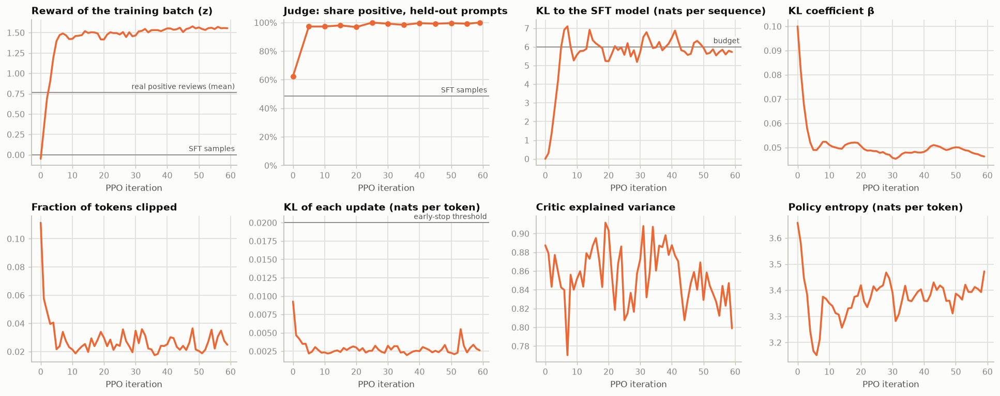
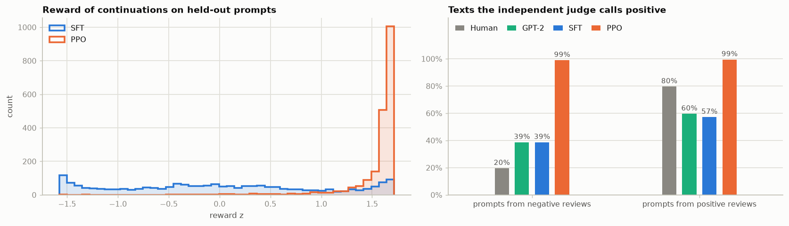

# RLHF with a learned reward model and PPO

The whole reinforcement-learning-from-human-feedback pipeline in one notebook, `rlhf_ppo_imdb.ipynb`:

1. **Data.** IMDB movie reviews, half positive and half negative.
2. **Supervised fine-tuning.** Pretrained GPT-2 (124M) learns to write movie reviews.
3. **Reward model.** A second GPT-2 learns a score from preference pairs (a positive review is preferred over a
   negative one) with the Bradley-Terry loss.
4. **PPO.** The fine-tuned model is trained against the reward model with hand-written PPO: per-token value
   function, GAE, clipped objective, and a KL penalty that keeps it close to the fine-tuned model.
5. **Evaluation.** Held-out prompts, scored by the reward model and by an independent sentiment classifier that
   took no part in training.

It is the follow-up to [`minimal-rlhf`](https://github.com/Aswanth0704/minimal-rlhf), which used TinyStories
(90% already positive), a VADER word lexicon as the reward, and a single REINFORCE step per batch.

## Results

One full run on an A100 80GB, 2,000 held-out prompts, one continuation per prompt. The notebook keeps every
number (with 95% bootstrap intervals), plot and sample as cell output.

| | Reward-model score (z) | Judge says positive | ...prompts from negative reviews | KL to SFT (nats/seq) | distinct-2 |
|---|---|---|---|---|---|
| Real review openings | +0.01 | 49.5% | 19.5% | – | 0.564 |
| Pretrained GPT-2 | +0.13 | 49.0% | 38.6% | 16.04 | 0.675 |
| SFT (where PPO starts) | −0.01 | 47.9% | 38.6% | 0 | 0.599 |
| **PPO** | **+1.54** | **99.2%** | **98.9%** | 5.50 | 0.525 |

- On the same prompt, PPO's continuation beats SFT's 96.4% of the time by the reward model and 93.5% of the time
  by the judge.
- The policy spends its KL budget of 6 nats and gives up some variety for it: distinct-2 falls from 0.599 to
  0.525. Its favoured words are a spread of ordinary praise ("excellent", "wonderful", "brilliant", "superb"),
  not one repeated token.
- It writes more uniformly positive text than real positive reviews do. That is what optimizing a score looks
  like, and the notebook's wrap-up section discusses it.





| Stage | Time on the A100 | Result |
|---|---|---|
| Fine-tuning, 1,496 steps | 6.4 min | validation loss 3.83 → 3.61 nats/token |
| Reward model, 1,000 steps | 1.9 min | 91.4% of held-out preference pairs ranked correctly |
| Reward model vs judge on SFT samples | 0.2 min | AUC 0.90 |
| PPO, 60 iterations of 512 episodes | 16.8 min | reward 0 → +1.5, KL held at the 6-nat budget |
| Evaluation | 0.7 min | table above |

The complete job, including loading models and data, took 33 minutes.

## Run it

### On Gilbreth

```bash
# once, on a login node (creates the conda env on scratch, registers the kernel, downloads IMDB / GPT-2 / judge)
cd /scratch/gilbreth/$USER/rlhf-ppo && bash -l setup_gilbreth.sh

# then either open rlhf_ppo_imdb.ipynb in Open OnDemand JupyterLab on an A100 with the "rlhf_ppo" kernel and Run All,
# or run it as a batch job (the notebook is executed in place and comes back with its outputs):
sbatch -A <account> -p a100-80gb -q standby run_notebook.sbatch
```

Pull results back to this machine:

```bash
rsync -avz --exclude '*.pt' gilbreth:/scratch/gilbreth/$USER/rlhf-ppo/out/ ./out/
```

### Anywhere else

```bash
pip install -r requirements.txt
jupyter lab rlhf_ppo_imdb.ipynb
```

The full run was done on an A100 80GB. Peak GPU memory was not measured; if a smaller card runs out during PPO,
lower `ppo_minibatch`. Without a GPU the notebook switches to a smoke mode (a few hundred reviews, three PPO
iterations, a few minutes on a laptop) that only checks that every cell runs.

### Re-running and changing settings

- Every stage saves its result in `out/` together with the settings that produced it. A second run loads all
  stages from there, and a stage retrains only when its settings changed. Delete a file in `out/` to force it.
- All settings are in the `CFG` dictionary at the top of the notebook. They can also be overridden without
  editing, for example `RLHF_CFG='{"ppo_kl_target": 3}' jupyter nbconvert --execute ...`, or for a batch job
  `sbatch ... --export=ALL,RLHF_CFG='{"ppo_kl_target": 3}' run_notebook.sbatch`.
- Runs are seeded. On the A100, two independent runs with the same settings produced identical results.

## Layout

```
rlhf_ppo_imdb.ipynb   the whole project, with outputs from the A100 run
setup_gilbreth.sh     one-time cluster setup (idempotent)
run_notebook.sbatch   runs the notebook headless on one GPU
requirements.txt      pinned versions (torch 2.14.1, transformers 5.24.1)
plots/                figures from the full run
out/                  checkpoints, plots, results.json, ppo_log.json (git-ignored)
hf_cache/             downloaded models and data (git-ignored)
```

## Limits

- The preferences are simulated from review labels. Real RLHF collects comparisons between model outputs.
- Episodes have a fixed length of 56 tokens; the policy never learns when to stop.
- One seed, and one small, well-defined target ("be positive").

The notebook ends with six exercises, including switching off the KL penalty to watch the reward model get gamed
and replacing PPO with a single unclipped policy-gradient step.
