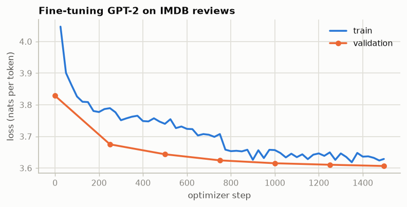
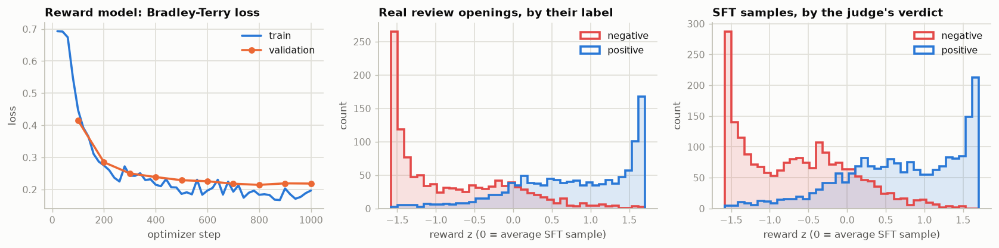
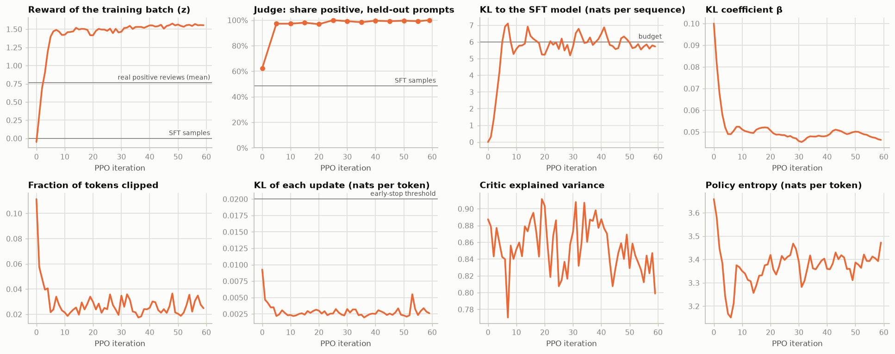
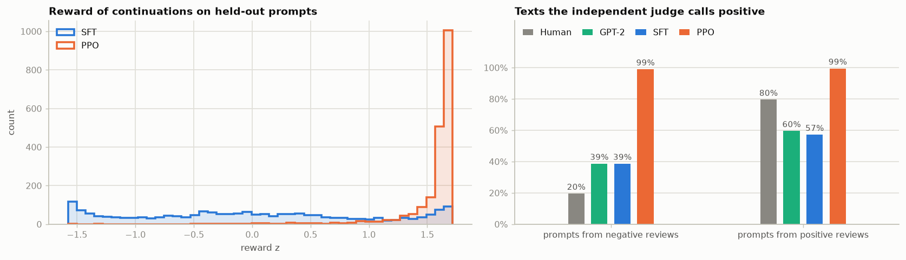

# RLHF with a learned reward model and PPO on GPT-2: project report

Report date: 25 November 2026.

Every result in this report comes from one from-scratch execution of `rlhf_ppo_imdb.ipynb` on an NVIDIA A100 80GB (Slurm job 12528861 on Purdue's Gilbreth cluster, seed 0). The numbers are stored in `out/results.json` and `out/ppo_log.json`, and the notebook keeps them as cell outputs.

## 1. Summary

The project implements the whole reinforcement-learning-from-human-feedback (RLHF) pipeline in a single notebook:

1. fine-tune a language model on the target domain,
2. learn a reward model from preference pairs,
3. improve the language model against that reward with PPO, held close to the fine-tuned model by a KL penalty,
4. evaluate on held-out prompts with a judge that took no part in training.

The task is to make GPT-2 write positive movie reviews. The starting point is a model that writes positive and negative reviews about equally often, so there is something real to steer.

| Measured on 2,000 held-out prompts | Before PPO (fine-tuned model) | After PPO |
|---|---|---|
| Continuations the independent judge calls positive | 47.9% | 99.2% |
| Same, for prompts taken from negative reviews | 38.6% | 98.9% |
| Reward-model score, in standard deviations above the average fine-tuned sample | −0.01 | +1.54 |
| Distance from the fine-tuned model (KL, nats per sequence; the budget was 6) | 0 | 5.50 |
| Vocabulary diversity (distinct-2) | 0.599 | 0.525 |

- **Head to head:** on the same prompt, the PPO continuation beats the fine-tuned model's continuation 96.4% of the time by the reward model and 93.5% of the time by the judge.
- **Reward model:** it ranks 91.4% of held-out preference pairs correctly.
- **Cost:** the full run takes 33 minutes on one A100, of which PPO is 16.8 minutes (60 iterations, 30,720 sampled episodes).
- **Price of the improvement:** distinct-2 falls by about 12%, and the policy writes more uniformly positive text than real positive reviews do.
- **Main caveats:** the preferences are simulated from review labels, the run uses one seed, and episodes have a fixed length.

## 2. Project details

### 2.1 Goal

This is the follow-up to [`minimal-rlhf`](https://github.com/Aswanth0704/minimal-rlhf). That project ran the RLHF loop on TinyStories with a small character model, and three things limited what it could show. This project changes each of them.

| | `minimal-rlhf` | This project |
|---|---|---|
| Data | TinyStories, 90% already positive | IMDB reviews, 50% positive |
| Model | 0.8M-parameter character model trained from scratch | Pretrained GPT-2 small (124M parameters) |
| Reward | VADER word lexicon | A network trained on preference pairs |
| RL update | One REINFORCE step per batch | PPO: value function, GAE, clipped objective, several epochs per batch |
| Evaluation | The training reward on the training prompt | Held-out prompts and an independent judge |

Two requirements shaped the design: everything lives in one notebook that runs top to bottom, and the training loops are written by hand in plain PyTorch so that each step can be read. Hugging Face is used only to load pretrained weights, the tokenizer and the dataset.

### 2.2 Deliverables

| File | Purpose |
|---|---|
| `rlhf_ppo_imdb.ipynb` | The whole project: 31 cells (14 explanation, 17 code), with outputs from the A100 run |
| `README.md` | Short description, results and run instructions |
| `REPORT.md` | This report |
| `setup_gilbreth.sh` | One-time cluster setup: conda environment, Jupyter kernel, download of data and models |
| `run_notebook.sbatch` | Runs the notebook headless on one GPU |
| `requirements.txt` | Pinned package versions |
| `plots/` | The four figures from the full run |
| `out/` | `results.json`, `ppo_log.json` and plots; on the cluster also the four stage checkpoints |

The cluster copy is at `/scratch/gilbreth/athani/rlhf-ppo/`. Its `out/` directory holds `sft.pt` (652 MB), `reward_model.pt` (498 MB), `calibration.pt` (2 MB) and `ppo.pt` (652 MB).

### 2.3 Environment

| | |
|---|---|
| GPU | NVIDIA A100 80GB PCIe, one card |
| Cluster | Purdue Gilbreth, partition `a100-80gb`, QoS `standby`, 8 CPU cores, 48 GB RAM |
| Software | Python 3.11, torch 2.14.1 (CUDA 13.0 build), transformers 5.24.1, datasets 5.2.0 |
| Models | `openai-community/gpt2` (policy, reference, reward-model trunk, critic trunk); `distilbert/distilbert-base-uncased-finetuned-sst-2-english` (judge) |
| Dataset | `stanfordnlp/imdb` |

## 3. Pipeline and data

```
                     ┌─► 2. SFT: fine-tune GPT-2 on reviews ──┐
 IMDB reviews ─► 1. ─┤                                        ├─► 4. PPO ─► 5. Evaluation
 (half negative)     └─► 3. Reward model from preferences ────┘
```

### 3.1 Data preparation

IMDB has 100,000 reviews: 25,000 labeled for training, 25,000 labeled for testing, and 50,000 unlabeled. The notebook replaces `<br />` tags, unescapes HTML entities and collapses whitespace. It then removes reviews that appear more than once across the splits, which drops 1,537 and leaves 98,463. A duplicated review stays in the test split first, then train, then unlabeled, so no evaluation text can reach a training stage. Each split is shuffled, because the labeled splits are stored sorted by label.

Each split has exactly one job:

| Split | Reviews after cleaning | Used for |
|---|---|---|
| `unsupervised` | 48,885 | Fine-tuning (47,885 training and 1,000 validation sequences of 128 tokens) and the pool of 47,885 prompts for PPO rollouts |
| `train` | 24,779 | Reward-model preference pairs: 21,744 reviews for training (10,867 positive, 10,877 negative) and 2,416 for validation (1,208 of each) |
| `test` | 24,799 | 2,000 evaluation prompts (1,000 from negative reviews, 1,000 from positive) and 256 separate development prompts for watching PPO train |

The reward model and the evaluation use only reviews with at least 64 tokens, so every window and every prompt has a full-length real text behind it.

### 3.2 One sequence layout

Every episode has the same shape: a start token, the first 8 tokens of a real review as the prompt, and 56 tokens written by the policy (about 40 words).

```
index:    0       1 … P          P+1 … P+T              P = 8 prompt tokens
token:  [BOS]   prompt          continuation            T = 56 generated tokens
                                                        L = 1 + P + T = 65
```

- **No padding and no masks.** Every sequence in the RL code has exactly this shape, which removes a common source of off-by-one errors.
- **Fixed horizon.** GPT-2's only special token, `<|endoftext|>`, serves as `[BOS]` and is removed from the set of tokens the policy may write. Episodes always run for 56 steps and the action space has 50,256 tokens.
- **Index rule.** The hidden state at index `j` predicts the token at index `j+1`. The generated tokens sit at indices `P+1 … P+T`, so their distributions and the critic's values are read at indices `P … P+T-1`. The reward model reads the last index.

## 4. Implementation

### 4.1 Shared building blocks

| Piece | What it does |
|---|---|
| `next_token_logits`, `action_logprobs` | The one definition of the policy's distribution: GPT-2's logits with the end-of-text column sliced off. Fine-tuning, sampling, PPO and evaluation all use it. |
| `generate` | A hand-written sampling loop with key-value caching. The prompt is run once and each new token costs one single-token forward pass. It samples at temperature 1 over the full vocabulary and returns the log-probability of every sampled token. |
| `ScalarGPT` | A GPT-2 trunk with a zero-initialized `Linear(768, 1)` head that outputs one number per position. It is used twice: as the reward model (read at the last position) and as PPO's critic (read at every action position). |
| `cached` | Stage cache. Each stage saves its result in `out/` with the settings that produced it. A later run loads the result only if the settings are identical, so a stale checkpoint is never reused silently. |

Two decisions here matter for correctness:

- **The sampled distribution is the scored distribution.** `minimal-rlhf` sampled with top-k but computed log-probabilities under the full softmax, which are two different distributions. Here both come from the same function.
- **PPO runs in 32-bit floats.** GPT-2's logits are around −100, where 16-bit floats are spaced 0.5 apart, so rounding logits to bf16 shifts log-probabilities by about 0.1 nats per token. That is too coarse for PPO's probability ratios. The output head always runs in fp32, and the PPO stage runs entirely in fp32. Only the transformer trunk uses bf16, and only in fine-tuning and reward-model training.

### 4.2 Stage 2: supervised fine-tuning (SFT)

Ordinary next-token training of pretrained GPT-2 on the first 128 tokens of each unlabeled review. No labels are used, so the model has no preference between positive and negative text.

- **Optimizer:** AdamW, learning rate 5e-5 with 100 warm-up steps and cosine decay to 10%, weight decay 0.01, gradient clipping at 1.0.
- **Schedule:** 2 epochs at batch size 64, which is 1,496 steps.
- **Role later:** the result is both the starting policy for PPO and the frozen reference that the KL penalty measures distance from.

### 4.3 Stage 3: reward model

- **Architecture:** `ScalarGPT` initialized from pretrained GPT-2. With a causal model the last position is the only one that has seen the whole text, so the score is read there.
- **Preferences:** a pair is one text from a positive review and one from a negative review, with the positive one preferred. The pairing is redrawn at random every step.
- **Text shape:** 64-token windows in exactly the PPO layout. Half are review openings and half are cut from a random position. A model trained on whole reviews (about 300 tokens) would later be scoring a kind of text it had never seen.
- **Loss:** Bradley-Terry. The probability that `a` is preferred over `b` is a logistic function of the score difference:

$$
\mathcal{L}_{\text{RM}} = -\mathbb{E}_{(a \succ b)} \log \sigma\big(r(a) - r(b)\big)
$$

- **Training:** 1,000 steps of 64 pairs, AdamW, learning rate 2e-5 with 60 warm-up steps, weight decay 0.01.
- **Normalization:** the model scores 4,096 samples from the SFT model, and its output is shifted and scaled so that those samples have mean 0 and standard deviation 1. The constants are folded into the head's weights. A reward of +1 then means "one standard deviation better than what the starting policy typically writes".

### 4.4 The independent judge

PPO pushes the reward model's score up, and a policy can learn to exploit quirks of the one network it trains against. The notebook therefore keeps a second opinion that never enters training: an off-the-shelf DistilBERT sentiment classifier fine-tuned on SST-2, which is a different architecture trained on a different dataset. If the reward-model score rises and the judge agrees, the improvement is real.

The judge is an imperfect instrument on text this short. On the 2,000 real, labeled 64-token review openings it is 80.0% accurate.

### 4.5 Stage 4: PPO setup

| Network | Starts from | Trained in this stage |
|---|---|---|
| Policy | The SFT model | Yes |
| Reference | The SFT model | No, frozen |
| Reward model | Stage 3, normalized | No, frozen |
| Critic | The normalized reward model, which already predicts the final score from a full text | Yes |

- **Critic warm-up:** before PPO the policy equals the reference, so the expected return from every step is the final score. The critic is trained for 2 epochs on the 4,096 calibration samples to predict it at every position.
- **Dropout is off** for all four networks, so the probability ratio is exactly 1 before the first gradient step of each iteration.
- **The policy is always rebuilt from the saved SFT checkpoint**, so re-running the PPO cell never continues from an earlier run's weights.

### 4.6 Stage 5: evaluation

Each model writes one continuation for each of the 2,000 held-out prompts, with the same random seed. Four rows are compared: the real openings of those reviews, pretrained GPT-2, the SFT model and the PPO policy.

| Metric | What it tells you |
|---|---|
| Reward z | The reward model's score, the quantity PPO optimized |
| Judge positive | Share of texts the independent judge calls positive, overall and split by the sentiment of the review the prompt came from |
| Win rate | How often PPO's continuation beats SFT's on the same prompt |
| KL to SFT | How far the model's distribution is from the SFT model, in nats per sequence |
| SFT NLL | How surprising the text is to the SFT model, in nats per token. Much higher than the SFT row means unnatural text. |
| distinct-1, distinct-2 | Unique tokens and token pairs divided by the total, across all continuations |
| Repeats | Share of token pairs within a continuation that already appeared earlier in it |

Means carry 95% bootstrap intervals over prompts (1,000 resamples).

### 4.7 Settings

| Stage | Setting | Value |
|---|---|---|
| Layout | Prompt length, generated length | 8, 56 tokens |
| SFT | Sequence length, batch size, epochs | 128, 64, 2 |
| SFT | Learning rate, warm-up steps, weight decay | 5e-5, 100, 0.01 |
| Reward model | Steps, pairs per step | 1,000, 64 |
| Reward model | Learning rate, warm-up steps, weight decay | 2e-5, 60, 0.01 |
| Reward model | Share of windows that are review openings | 0.5 |
| Calibration | SFT samples for normalization and critic warm-up | 4,096 |
| PPO | Iterations, episodes per iteration | 60, 512 |
| PPO | Epochs per batch, minibatch size | 4, 128 |
| PPO | Clip range ε | 0.2 |
| PPO | Policy learning rate, critic learning rate | 1e-5, 3e-5 |
| PPO | Discount γ, GAE λ | 1.0, 0.95 |
| PPO | Gradient clipping | 1.0 |
| PPO | KL budget | 6 nats per sequence |
| PPO | β: initial, adaptation rate, minimum, maximum | 0.1, 0.2, 0.01, 10 |
| PPO | Early-stop threshold on the update's own KL | 0.02 nats per token |
| Evaluation | Prompts, bootstrap resamples | 2,000, 1,000 |

All settings are in one `CFG` dictionary at the top of the notebook and can be overridden through the `RLHF_CFG` environment variable. No hyperparameter search was run. These are the values of the first A100 run, with one change described in section 6.6.

## 5. Algorithm: PPO for text generation

### 5.1 Text generation as an RL problem

| RL term | Here |
|---|---|
| State | The prompt plus the tokens written so far |
| Action | The next token, one of 50,256 |
| Policy | The language model |
| Episode | 56 tokens, always |

### 5.2 Reward: score minus a KL penalty

Maximizing the reward model's score alone would fail. The reward model is only reliable on text that looks like reviews, and a policy free to move anywhere drifts into text that scores well without being good. RLHF therefore optimizes the normalized score `z` minus a penalty for moving away from the reference:

$$
R(x) = z(x) - \beta \sum_{t=0}^{T-1} \log \frac{\pi_\theta(a_t \mid s_t)}{\pi_{\text{ref}}(a_t \mid s_t)}
$$

The expectation of the sum is the KL divergence from the policy to the reference over whole continuations. As per-token rewards:

$$
r_t = -\beta \log \frac{\pi_\theta(a_t \mid s_t)}{\pi_{\text{ref}}(a_t \mid s_t)} + \mathbf{1}[t = T-1] \cdot z(x)
$$

Every token pays a small price for being more likely under the policy than under the reference, and the last token also collects the score of the finished text.

### 5.3 A KL budget instead of a fixed coefficient

The notebook fixes a budget in nats per sequence and lets β adapt. After each iteration, β goes up if the measured KL is over budget and down if it is under:

$$
\beta \leftarrow \mathrm{clip}\Big(\beta \cdot \exp\big(0.2 \cdot \mathrm{clip}(\mathrm{KL} / \mathrm{KL}_{\text{target}} - 1,\ -1,\ 1)\big),\ 0.01,\ 10\Big)
$$

A budget is easier to reason about than a coefficient, and it makes the run insensitive to the reward model's scale. Two reference points for the unit: restricting a 50/50 policy to its positive half costs ln 2 ≈ 0.7 nats, and turning around a prompt that the reference continues negatively 90% of the time costs ln 10 ≈ 2.3 nats.

### 5.4 Advantages

The critic predicts the total reward still to come from each state. Generalized advantage estimation (GAE) turns its one-step surprises into advantages, computed backwards through the episode, with the state after the last token treated as terminal:

$$
\delta_t = r_t + \gamma V(s_{t+1}) - V(s_t), \qquad \hat{A}_t = \delta_t + \gamma \lambda \hat{A}_{t+1}, \qquad V(s_T) = 0
$$

With a good critic, a token is credited only for the change in expected outcome that it caused. In REINFORCE every token in a sample shares one number. Advantages are normalized to zero mean and unit variance over the batch.

### 5.5 The clipped update

A batch of episodes is expensive to collect, so PPO reuses it for several gradient steps. That is safe only while the policy stays close to the one that collected the data. With the probability ratio ρ between the current policy and the one that sampled the batch, the clipped objective removes any incentive to move the ratio outside [1 − ε, 1 + ε]:

$$
\mathcal{L}_{\text{policy}} = -\mathbb{E}_t \min\big(\rho_t \hat{A}_t,\ \mathrm{clip}(\rho_t, 1-\epsilon, 1+\epsilon) \hat{A}_t\big), \qquad
\mathcal{L}_{\text{critic}} = \tfrac{1}{2} \mathbb{E}_t \big(V(s_t) - \hat{R}_t\big)^2
$$

where the return target is the advantage plus the critic's value at collection time. The policy and the critic are separate networks with separate AdamW optimizers.

As a second safeguard, each iteration tracks how far its own updates have moved the policy, estimated per token as the mean of ρ − 1 − log ρ, which is never negative. If the mean over an epoch exceeds 0.02 nats, the remaining epochs on that batch are skipped.

### 5.6 One iteration

```
for iteration in 1 … 60:
    prompts   ← 512 random 8-token review openings from the unlabeled pool
    x         ← policy.generate(prompts)                 # 56 tokens each, temperature 1, full vocabulary

    # no gradients; one forward pass per network
    logp_old  ← log π_θ(a_t | s_t)
    logp_ref  ← log π_ref(a_t | s_t)
    V_old     ← critic(s_t)
    z         ← reward_model(x)                          # one score per sequence

    r_t       ← −β · (logp_old − logp_ref);   r_last += z
    A, R      ← GAE(r, V_old, γ = 1, λ = 0.95)
    A         ← (A − mean(A)) / std(A)

    for epoch in 1 … 4:
        for each minibatch of 128 sequences:
            ρ ← exp(log π_θ(a | s) − logp_old)
            policy step on   −mean(min(ρ·A, clip(ρ, 0.8, 1.2)·A))
            critic step on   ½ · mean((critic(s) − R)²)
        if mean KL(old ‖ new) per token over the epoch > 0.02: stop using this batch

    KL        ← mean over sequences of Σ_t (logp_old − logp_ref)
    β         ← clip(β · exp(0.2 · clip(KL / 6 − 1, −1, 1)), 0.01, 10)
```

One iteration is 512 episodes (28,672 sampled tokens) and up to 16 gradient steps for each of the two trained networks. The full run is 30,720 episodes, 1.72 million sampled tokens and 960 policy updates.

## 6. Results

### 6.1 Supervised fine-tuning

| | Pretrained GPT-2 | After fine-tuning |
|---|---|---|
| Validation loss (nats per token) | 3.829 | 3.607 |
| Validation perplexity | 46.0 | 36.8 |

The validation loss fell at every checkpoint (3.675 at step 250, 3.624 at step 750, 3.607 at step 1,496). The fine-tuned model is neutral about sentiment, as intended: the judge calls 47.9% of its continuations positive.



### 6.2 Reward model

| Check | Result |
|---|---|
| Loss at the first step | ln 2, as required for a zero-initialized head (asserted) |
| Held-out preference pairs ranked correctly | 91.4% (85.6% after 100 steps, 90.9% after 500) |
| Validation Bradley-Terry loss | 0.218 |
| Agreement with the judge on 4,096 SFT samples (AUC) | 0.896 |
| Mean score of real positive openings | +0.76 |
| Mean score of real negative openings | −0.80 |
| Mean score of SFT samples | 0 by construction |

The accuracy is measured over all 1,208 × 1,208 pairs of held-out positive and negative review openings. The agreement with the judge matters most for what follows: the reward model was trained on human text, and an AUC of 0.90 on model-written text shows that it transfers.

The scores saturate. The highest-scoring of the 4,096 SFT samples received +1.70 and the lowest −1.58, with many samples close to each extreme. The top of that range is in effect the most reward any text can earn, which is the scale to read the PPO result against.



### 6.3 PPO training

The table shows the training log at selected iterations. Reward and KL describe the batch sampled at the start of that iteration, and the diagnostics describe the updates made on it. The judge column is measured on the 256 development prompts after those updates.

| Iteration | Reward (z) | KL (nats/seq) | β | Clipped tokens | Critic explained variance | Entropy (nats/token) | Judge positive, dev prompts |
|---|---|---|---|---|---|---|---|
| 0 | −0.05 | 0.00 | 0.100 | 11.1% | 0.89 | 3.66 | 62.5% |
| 5 | +1.40 | 5.98 | 0.049 | 2.2% | 0.84 | 3.17 | 97.3% |
| 10 | +1.42 | 5.58 | 0.051 | 2.2% | 0.85 | 3.35 | 97.3% |
| 20 | +1.42 | 5.23 | 0.051 | 3.0% | 0.90 | 3.42 | 96.9% |
| 30 | +1.47 | 5.72 | 0.046 | 3.5% | 0.87 | 3.39 | 99.2% |
| 40 | +1.55 | 6.49 | 0.048 | 2.5% | 0.89 | 3.36 | 99.6% |
| 50 | +1.56 | 5.95 | 0.050 | 2.0% | 0.83 | 3.39 | 99.6% |
| 59 | +1.55 | 5.72 | 0.046 | 2.5% | 0.80 | 3.47 | 100.0% |

- **Learning is fast.** The reward passes +1.4 after six iterations (3,072 episodes). After that the gains are small: the mean reward is 1.47 over iterations 10–19 and 1.55 over iterations 50–59.
- **The KL budget holds.** From iteration 10 on, the KL averages 5.94 nats (standard deviation 0.39) against a budget of 6. Its largest value was 7.10 at iteration 7, after which β pulled it back. β settled near 0.05 and never came close to its limits.
- **Updates stay small.** From iteration 10 on, 2.6% of tokens are clipped on average, and each iteration's own KL averages 0.0027 nats per token against the threshold of 0.02. The early stop never triggered: all 60 iterations ran their 4 epochs.
- **The critic is useful throughout.** Its explained variance stays between 0.77 and 0.91. The warm-up brought its loss to 0.139, where predicting a constant gives 0.5.
- **No entropy collapse.** Entropy dips from 3.66 to 3.15 nats per token by iteration 6 and recovers to 3.47 by the end.
- **Indexing is exact.** The log-probabilities recorded while sampling and those recomputed in one forward pass differ by at most 0.0001 nats in every iteration.



### 6.4 Held-out evaluation

2,000 prompts from the test split, one continuation per prompt, the same random seed for every model. Brackets are 95% bootstrap intervals.

| | Reward z | Judge positive | From negative-review prompts | From positive-review prompts |
|---|---|---|---|---|
| Real review openings | +0.01 [−0.04, +0.06] | 49.5% [47.3, 51.6] | 19.5% [17.1, 21.9] | 79.5% [77.2, 82.0] |
| Pretrained GPT-2 | +0.13 [+0.09, +0.16] | 49.0% [46.9, 51.2] | 38.6% [35.5, 41.7] | 59.5% [56.5, 62.6] |
| SFT (where PPO starts) | −0.01 [−0.05, +0.03] | 47.9% [45.6, 49.9] | 38.6% [35.5, 41.6] | 57.1% [54.1, 60.1] |
| **PPO** | **+1.54** [+1.53, +1.55] | **99.2%** [98.7, 99.6] | **98.9%** [98.2, 99.5] | **99.4%** [98.9, 99.8] |

| | KL to SFT (nats/seq) | SFT NLL (nats/token) | distinct-1 | distinct-2 | Repeats |
|---|---|---|---|---|---|
| Real review openings | – | 3.58 | 0.117 | 0.564 | 1.9% |
| Pretrained GPT-2 | 16.04 | 4.31 | 0.156 | 0.675 | 1.7% |
| SFT (where PPO starts) | 0.00 | 3.73 | 0.124 | 0.599 | 1.4% |
| **PPO** | 5.50 | 3.55 | 0.106 | 0.525 | 1.8% |

| On the same prompt, PPO beats SFT | Rate |
|---|---|
| According to the reward model | 96.4% [95.5, 97.2] |
| According to the judge | 93.5% [92.5, 94.5] |

What the numbers say:

- **The improvement is real, not an artifact of the reward model.** The judge, which PPO never trained against, moves from 47.9% to 99.2% together with the reward-model score.
- **The hard case is solved too.** For prompts taken from negative reviews, where the policy has to turn the text around, the judge's positive rate goes from 38.6% to 98.9%.
- **The policy went past human positive reviews.** Real positive openings score +0.76 on average in the reward model's validation set, and the judge calls 79.5% of the real positive openings in the evaluation set positive. PPO text scores +1.54, close to the reward ceiling of about +1.7, and the judge calls 99.4% positive. Optimizing a score produces unmistakable praise on every prompt, which is more uniform than what people write.
- **The text stays natural by the available proxies.** PPO text is slightly less surprising to the SFT model than the SFT model's own samples (3.55 against 3.73 nats per token) and its repetition rate is about the same as human text (1.8% against 1.9%). Pretrained GPT-2, for comparison, is far from the review style (4.31).
- **The cost is variety.** distinct-2 falls from 0.599 to 0.525 and distinct-1 from 0.124 to 0.106. The five most common tokens take 17.5% of all generated tokens, up from 15.1%.



### 6.5 What the policy learned

The tokens whose frequency grew most between the SFT and PPO continuations are a spread of ordinary praise, not one repeated word. The table lists ten of the twenty tokens with the largest relative increase, ordered by count:

| Token | Count in PPO texts | Count in SFT texts |
|---|---|---|
| wonderful | 192 | 26 |
| truly | 151 | 26 |
| superb | 116 | 19 |
| brilliant | 110 | 15 |
| perfect | 101 | 17 |
| fantastic | 82 | 11 |
| unique | 73 | 12 |
| beautifully | 69 | 7 |
| incredible | 53 | 8 |
| stunning | 50 | 6 |

Two prompts from negative reviews, continued by both models:

> **Prompt:** "Believe it or not, this was"
>
> **SFT** (z = −1.49, judge: negative): once very successful. Now it's virtually extinct. There's no writing, no history, nothing aesthetically interesting, no acting...Except for the fact that there's a flyer on the wall half a miles from MGM Studio 3. I suspect the movie was supposed to broadcast the terrible
>
> **PPO** (z = +1.68, judge: positive): my very first movie. I found it amazing how even when I was younger, I still loved it. That's why I love the movie now. It keeps me fascinated and depressed about the individual in my life as a person. I think the movie is a unique document of life

> **Prompt:** "I should have realized that any two-"
>
> **SFT** (z = −0.51, judge: negative): dimensional cinematic experience cannot beat an attempt made by the mighty Five O'Clock News Network (which topped off this failure last year). One cannot merely look at the impressive scenery of Lake Superior and draw comparisons to the jus sad kind. Please note that these are not plans made by
>
> **PPO** (z = +1.54, judge: positive): dimensional cinematic experience is a very good one. In this film I wanted to see what aspects of life Americans have to endure during the Cold War. I love the story because it shows the people on both sides in every world. And while everyone is in their own personal plans, it

PPO changed the sentiment, not the coherence. Both models write locally fluent text that wanders, which is the level of GPT-2 small.

### 6.6 Choice of 60 iterations

The first full run used 120 PPO iterations. Its second half added almost nothing, so the default became 60. This is the only setting changed after seeing results, and both runs were evaluated on the same 2,000 prompts.

| | 120 iterations (first run) | 60 iterations (final) |
|---|---|---|
| Reward z | +1.565 | +1.542 |
| Judge positive | 99.2% | 99.2% |
| Judge positive, negative-review prompts | 99.1% | 98.9% |
| KL to SFT | 5.62 | 5.50 |
| distinct-2 | 0.525 | 0.525 |
| PPO stage time | 30.9 min | 16.8 min |

## 7. Verification

### 7.1 Checks built into the notebook

Index mistakes in this kind of code do not crash; they quietly train on the wrong thing. The notebook asserts the following on every run.

| Check | What it would catch |
|---|---|
| Log-probabilities recorded while sampling equal those recomputed in one forward pass (gap below 0.05 nats; measured 0.0001) | Logits and actions shifted against each other; cache bugs |
| Changing the last token leaves every policy log-probability and critic value unchanged, and changes the reward | A position that can see its own future; reward read at the wrong place |
| A hand-computed GAE example, for λ = 1 and λ = 0 | Mistakes in the advantage recursion |
| A fresh policy has zero KL to the reference without sharing memory with it | A stale or aliased reference |
| The ratio is 1 on the first minibatch of every iteration | Dropout left on; mismatched old log-probabilities |
| The reward model's first loss is ln 2 and its validation accuracy exceeds 75% | Broken pairing or readout |
| Reference and reward-model weights are unchanged after PPO | Accidental training of a frozen network |
| The first rollout's KL to the reference is 0 | Weights carried over from an earlier run |

### 7.2 Tests run during development

| Test | Result |
|---|---|
| Smoke run on a laptop (a few hundred reviews, three PPO iterations), as a script and as a notebook | Every cell runs and every assertion passes |
| PPO on a laptop with a synthetic reward (count of the token " the"), independent of the reward model | Over 14 iterations the reward rose from +0.25 (mean of the first three) to +4.03 standard deviations (mean of the last three) |
| Script and notebook with the same settings | Identical reported numbers |
| Second execution of the notebook | All four stages loaded from `out/`, checkpoints untouched, identical `results.json` |
| fp32 log-probabilities with different batch splits on the A100 | Agree to 0.0001 nats |

### 7.3 Precision benchmark

A benchmark on the A100 compared the options for the PPO forward and backward pass. Errors are against strict fp32.

| Mode | Mean token log-prob error (nats) | Largest error (nats) | Policy step, 128 sequences |
|---|---|---|---|
| Strict fp32 (used) | reference | reference | 0.405 s |
| TF32 matrix multiplies | 0.0033 | 0.048 | 0.133 s |
| bf16 trunk, fp32 head | 0.0094 | 0.53 | 0.187 s |

Strict fp32 is three times slower than TF32 and still gives a 16-second iteration, so the exact option was kept. Sampling 512 continuations of 56 tokens takes 1.15 seconds.

## 8. Compute and run time

| Stage | Time on the A100 |
|---|---|
| Data preparation | 0.4 min |
| Fine-tuning, 1,496 steps | 6.4 min |
| Reward model, 1,000 steps | 1.9 min |
| Calibration, 4,096 samples | 0.2 min |
| PPO, 60 iterations | 16.8 min (median 15.7 s per iteration) |
| Evaluation | 0.7 min |
| **Sum of stages** | **26.5 min** |
| **Whole job** | **32 min 35 s** |

The whole-job time also covers everything outside the timed stages, such as start-up, imports and model loading.

All five Slurm jobs of the project ran on one A100 each under the `standby` QoS:

| Job | Purpose | Elapsed |
|---|---|---|
| 12528245 | Speed and precision benchmark | 0:46 |
| 12528246 | First full run as a script, 120 PPO iterations | 41:19 |
| 12528860 | Script run with the final settings | 24:26 |
| 12528861 | Final notebook, executed from scratch (source of this report's numbers) | 32:35 |
| 12530693 | Second execution of the notebook on cached stages, with a check that the checkpoints were unchanged | 9:04 |

Total GPU time for the project was 1 hour 48 minutes.

Peak GPU memory of the pipeline was not measured. The stand-alone benchmark peaked at 27.3 GB. It uses the same batch sizes but loads one network instead of five and holds full log-probability tables that the pipeline does not, so it is only a rough indication.

## 9. Limitations

- **The preferences are simulated.** Real RLHF collects comparisons between model outputs from annotators. Here the comparisons come from labels that review authors gave their own text. The reward model, the loss and everything downstream are the real thing, but the "human feedback" is a stand-in.
- **One seed.** PPO runs differ from seed to seed. The intervals in this report cover sampling of prompts only, not run-to-run variation.
- **Fixed-length episodes.** The policy always writes exactly 56 tokens and never learns when to stop.
- **A small, well-defined target.** "Be positive" is easy to learn and easy to check. Preferences such as "be helpful" need far more data and are far harder to evaluate.
- **The policy optimizes the score, not the intent.** It writes emphatic praise on every prompt and its reward sits near the reward model's ceiling. The KL budget is the setting that limits this.
- **The judge is a second opinion, not ground truth.** It is 80% accurate on real 64-token openings.
- **Fluency is measured by proxy.** SFT NLL, distinct-n and the repetition rate are automatic measures. Nobody rated the text beyond reading the printed samples.

## 10. Next steps

The notebook ends with six exercises. Each needs only a settings change or a small edit:

1. **Remove the KL penalty** (`ppo_kl_target=None`, `ppo_beta_init=0.0`) and watch what the text turns into.
2. **Policy gradient without PPO** (`ppo_epochs=1`, `ppo_minibatch=ppo_batch`, `ppo_clip=1e9`), the kind of update `minimal-rlhf` used, compared at the same number of sampled episodes.
3. **Reranking instead of RL:** sample 16 continuations per prompt from the SFT model and keep the one the reward model likes best.
4. **Tighter and looser budgets:** `ppo_kl_target` of 2 and 12, plotting judge-positive rate against KL.
5. **Noisy annotators:** flip the preferred side in 20% of the reward-model pairs.
6. **Episodes that end:** put `<|endoftext|>` back into the action space and add a mask.

Running several seeds is the other obvious addition, since it would put run-to-run intervals on the table in section 6.4.

## 11. Reproducing the results

```bash
# once, on a Gilbreth login node: conda env on scratch, Jupyter kernel, download of IMDB / GPT-2 / judge
cd /scratch/gilbreth/$USER/rlhf-ppo && bash -l setup_gilbreth.sh

# full run as a batch job; the notebook is executed in place and comes back with its outputs
sbatch -A <account> -p a100-80gb -q standby run_notebook.sbatch

# a variation without editing the notebook
sbatch -A <account> -p a100-80gb -q standby --export=ALL,RLHF_CFG='{"ppo_kl_target": 3}' run_notebook.sbatch
```

The notebook can also be opened in Open OnDemand JupyterLab with the `rlhf_ppo` kernel and run with Run All. With the checkpoints in `out/` it loads every stage instead of retraining. Runs are seeded: two independent A100 runs with the same settings produced identical results. Without a GPU the notebook switches to a smoke mode that only checks that every cell runs.
